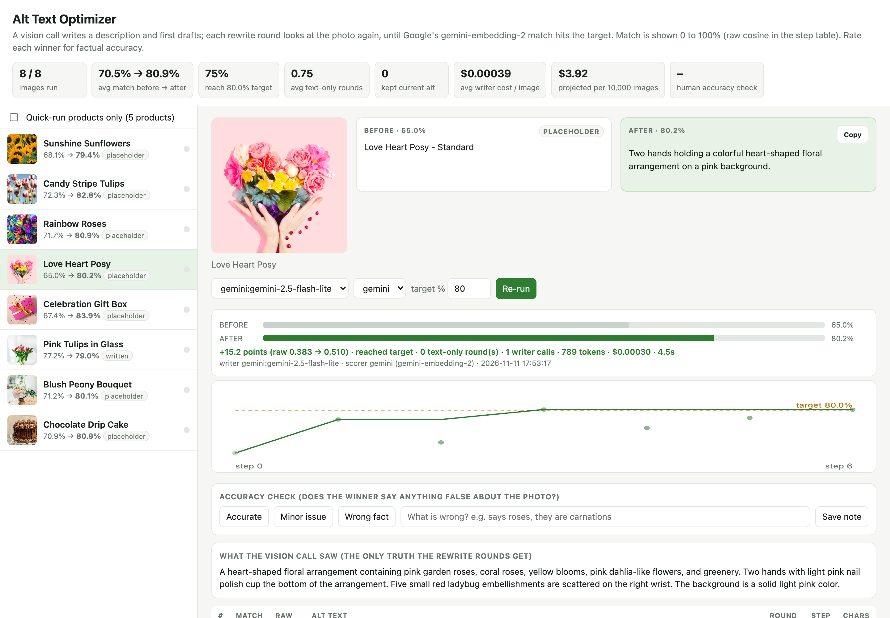
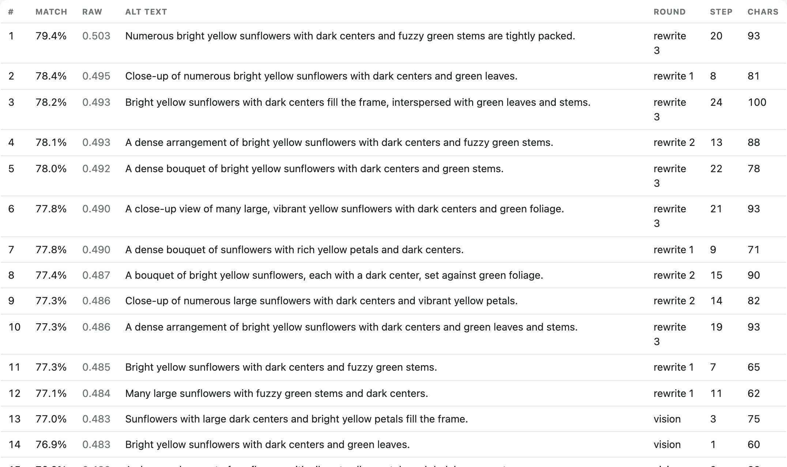
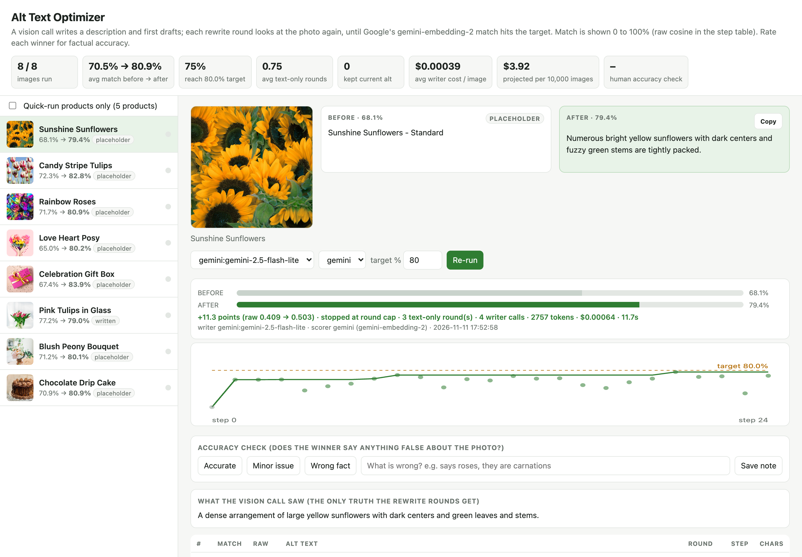

# Alt Text Optimizer

Most product catalogs have alt text like `Rainbow Roses - Standard`. It helps no one: not
screen-reader users, not Google Images, not the AI shopping assistants that now read product pages.

This tool writes alt text that actually describes the photo, and **measures** how well it does.
A vision model writes candidates; Google's multimodal `gemini-embedding-2` scores each one against the
image itself; the writer sees the scores and rewrites until a candidate reaches the target. The current
alt competes too, so a good human-written alt is kept rather than replaced.



## Results on the demo catalog

Eight product photos, all with placeholder or thin alt text, run once with the default settings:

| Product | Before | After | Match |
|---|---|---|---|
| Love Heart Posy | Love Heart Posy - Standard | Two hands holding a colorful heart-shaped floral arrangement on a pink background. | 65.0% → **80.2%** |
| Celebration Gift Box | Celebration Gift Box - Standard | A hot-pink gift box tied with a gold satin ribbon and bow, scattered with gold heart confetti on a light pink background. | 67.4% → **83.9%** |
| Candy Stripe Tulips | Candy Stripe Tulips - Standard | White tulips with red stripes stand tall on green stems beneath a vivid blue sky. | 72.3% → **82.8%** |
| Chocolate Drip Cake | Chocolate Drip Cake - Standard | A rich chocolate layer cake with ganache drip and chocolate buttercream rosettes, presented on a white filigree cake stand. | 70.9% → **80.9%** |
| Blush Peony Bouquet | Blush Peony Bouquet - Standard | Blush peonies and peach garden roses fill a glass jar, accented by white blooms and eucalyptus, tied with a flowing tan ribbon. | 71.2% → **80.1%** |
| Pink Tulips in Glass | Pink tulips in a glass vase on a white table | Pink and white double tulips in a glass vase with a simple light yellow twine bow on a white background. | 77.2% → **79.0%** |

**Average 70.5% → 80.9%. Total cost for all eight: $0.003**, about **$4 per 10,000 images** with the
default writer (`gemini-2.5-flash-lite`). The Google AI Studio free tier covers a small catalog outright.

## How it works

```
photo ──► vision call: describe what is visible + 6 candidates
              │
              ▼
          score every candidate (and the current alt) against the image embedding
              │
     best ≥ target? ── yes ──► done (keep current alt if nothing beats it)
              │ no
              ▼
          rewrite call: photo + description + scored history ──► 6 new candidates ──► score ... (max 3 rounds)
```

- **One embedding per image**, cached; candidates are cheap text embeddings.
- **Precision beats length.** The prompts demand exact nouns ("sliced strawberries", "kraft paper wrap") and
  forbid hedging ("strawberry-like"), which the scorer penalises.
- **Product copy names things, never adds them.** It is used only to name what the photo shows correctly.
- **Your brand never appears** in alt text (`OWN_BRANDS`), and openers like "An image of" are stripped.
- **Every step is kept**, so you can see why a winner won:



The raw cosine between an image and its best caption tops out around 0.55, so the viewer shows a 0 to 100%
scale (`SCALE_A`, `SCALE_B` in `optimizer.py`) where a near-perfect caption reads around 85%.

## Quick start

```bash
git clone https://github.com/rodrig0055/alt-text-optimizer && cd alt-text-optimizer
cp .env.example .env              # add a Google AI Studio key (free): aistudio.google.com/apikey
uv run python prepare.py examples/demo.csv
uv run python optimizer.py all    # optimise every product
uv run python server.py           # viewer at http://localhost:8777
uv run python export.py           # data/alt_text.csv, ready for your CMS
```

Your own catalog is a CSV with `id, name, image, current_alt, copy` (`image` is a URL or a file path;
`url` is optional). See [examples/demo.csv](examples/demo.csv).

## Scale it

- `batch.py` runs the whole catalog, resumable, paced for the free tier (`WRITER_RPM`, `EMBED_RPM`), and
  stops cleanly when the daily quota runs out.
- `compare.py` runs several writers (Gemini, OpenAI, Anthropic) over the same products and reports average
  match, cost and speed, so you pick the cheapest writer that is accurate enough.
- `export.py` replaces an alt only when the new one gains at least one point, so good human alts survive.
- The viewer has an accuracy check per product: the score measures similarity, not truth, so a person
  should spot-check for facts the photo does not show.



## Tests

```bash
uv run pytest     # offline: the full loop against a fake writer and scorer
```

Demo photos are from [Unsplash](https://unsplash.com) and downloaded at run time, not stored here.

## License

MIT
